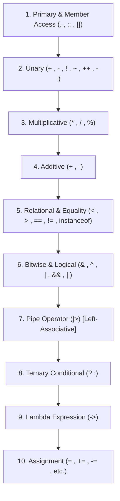
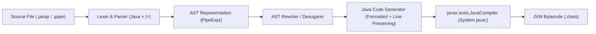

# Technical Architecture Document: Java Pipe (`|>`) Language Extension

**Project**: Java Pipe (`javapipe`)  
**Target Platform**: OpenJDK 17+ / Standard JVM  
**Status**: Architecture Design & Specification  
**Version**: 0.1.0-DRAFT  

---

## 1. Executive Summary & Objectives

The goal of the **Java Pipe** project is to introduce the pipe forward operator (`|>`) into Java, inspired by functional programming languages such as Elixir, F#, and OCaml, while preserving Java's strong static type system, existing standard libraries, tooling, and JVM performance.

### Core Objectives
1. **Readable Functional Pipelines**: Replace deeply nested method invocations and clunky intermediate variable assignments with linear, left-to-right pipelines.
2. **Zero Runtime Overhead**: Desugar directly into standard, idiomatic Java bytecode or source code without introducing a heavy custom runtime or proprietary functional classes.
3. **Strict Java Compatibility**: Generate 100% compliant standard Java source code that can be compiled with standard `javac` (JDK 17, 21, and beyond).
4. **Transparent Debugging**: Guarantee line-number alignment and provide source-map metadata so exceptions and debugger breakpoints map cleanly to original source lines.

---

## 2. Operator Syntax, Grammar, and Precedence

### 2.1 Lexer Specification
The lexer recognizes the two-character sequence `|>` as a distinct token:
- **Token Name**: `PIPE` / `OP_PIPE`
- **Pattern**: `|>`
- **Disambiguation**: Must not conflict with bitwise OR (`|`), logical OR (`||`), bitwise OR assignment (`|=`), or lambda arrow (`->`). The lexer applies the standard *maximal munch* rule: when encountering `|` followed by `>`, it produces `PIPE` rather than `BIT_OR` followed by `GT`.

### 2.2 Operator Precedence and Associativity

In functional pipeline design, pipe forward expressions must bind looser than standard arithmetic, relational, and equality operators, but tighter than assignment operators.



- **Associativity**: **Left-associative**  
  `a |> b |> c` parses unambiguously as:  
  `((a |> b) |> c)`
- **Precedence Level**: Placed between logical OR (`||`) and conditional ternary (`? :`), ensuring expressions like:  
  `var x = a + b |> f`  
  parse as:  
  `var x = ((a + b) |> f)`

---

## 3. Desugaring Semantics & Transformation Rules

The Java Pipe operator supports four distinct transformation forms based on the syntactic structure of the right-hand operand (`RHS`):

### 3.1 Form A: Method Reference (`expr |> Target::method`)
When the right-hand side is a method reference:

1. **Instance Method on Receiver**:  
   If the method reference refers to an instance method where the piped expression acts as the receiver:
   ```java
   // Java Pipe
   var result = " hello world " |> String::trim |> String::toUpperCase;

   // Desugared Java
   var result = " hello world ".trim().toUpperCase();
   ```

2. **Static Method Application**:  
   If the method reference refers to a static method where the piped expression acts as the first argument:
   ```java
   // Java Pipe
   var result = input |> Integer::parseInt |> Math::abs;

   // Desugared Java
   var result = Math.abs(Integer.parseInt(input));
   ```

### 3.2 Form B: Method Call Invocations (`expr |> method(args...)`)
When the right-hand side is a method invocation:

1. **Receiver Method Chaining (OO / Stream Semantics)**:  
   In Java, methods invoked directly on objects (such as `Stream`, `List`, `String`) treat the piped value as the receiver:
   ```java
   // Java Pipe
   var names = users
       |> stream()
       |> filter(user -> user.isActive())
       |> map(User::getName)
       |> sorted()
       |> toList();

   // Desugared Java
   var names = users
       .stream()
       .filter(user -> user.isActive())
       .map(User::getName)
       .sorted()
       .toList();
   ```

2. **First-Argument Application (Elixir-Style Free Functions)**:  
   When targeting static helper methods or functional utilities:
   ```java
   // Java Pipe
   var result = text |> StringUtils.capitalize() |> HashUtils.sha256(salt);

   // Desugared Java
   var result = HashUtils.sha256(StringUtils.capitalize(text), salt);
   ```

### 3.3 Form C: Lambda Expressions (`expr |> param -> body`)
When the right-hand side is an anonymous lambda function:

```java
// Java Pipe
var result = 5
    |> value -> value * 2
    |> value -> value + 10;
```

**Desugaring Strategies**:
- **Strategy 1: IIFE / Functional Interface Adapter (Zero-dependency)**
  ```java
  var result = ((java.util.function.Function<Integer, Integer>) (value -> value + 10))
      .apply(((java.util.function.Function<Integer, Integer>) (value -> value * 2)).apply(5));
  ```
- **Strategy 2: Inline Scope Expression (Fastest Execution, No Allocation)**
  For local variable declarations, the compiler can generate an immediate evaluation block or synthetic local scope:
  ```java
  var result = switch (5) {
      case Integer _v1 -> switch (_v1 * 2) {
          case Integer _v2 -> _v2 + 10;
      };
  };
  ```
- **Strategy 3: Lightweight Embedded Runtime Helper**  
  A generated or inlined static helper:
  ```java
  static <T, R> R __pipe(T val, java.util.function.Function<T, R> fn) {
      return fn.apply(val);
  }
  // Desugared:
  var result = __pipe(__pipe(5, value -> value * 2), value -> value + 10);
  ```

---

## 4. Compiler Architecture Evaluation

We evaluate four primary architectures for implementing Java Pipe:

| Architecture | Feasibility | JVM Upgradability | Tooling Impact | Recommendation |
| :--- | :--- | :--- | :--- | :--- |
| **A. Javac Compiler Plugin (`com.sun.source.util.Plugin`)** | Low | Very Low (JDK internal modules sealed in JDK 17/21) | Breaks standard javac parse phase | ❌ Reject |
| **B. Bytecode Instrumentation (Java Agent / ASM)** | Medium | Low (Syntax errors occur before bytecode generation) | Cannot parse new source syntax | ❌ Reject |
| **C. OpenJDK Javac Fork** | High | Low (High maintenance burden, custom JDK build required) | Requires users to swap JVM | ❌ Reject |
| **D. Source-to-Source Transpiler & Frontend CLI** | **Very High** | **High (100% decoupled from JDK internal changes)** | Works with any standard JDK 17/21+ | **✅ Selected** |

### Selected Architecture: Source-to-Source Frontend Transpiler (`javapipec`)
- **Parser**: Extensible Java 17+ grammar extended with the `|>` operator.
- **AST Transformer**: Rewrites `PipeExpression` AST nodes into idiomatic Java method calls, method references, and function applications.
- **Source Code Generator**: Emits standard `.java` files with line-number mapping.
- **Compiler Orchestrator**: Invokes `javax.tools.JavaCompiler` (standard system `javac`) programmatically to emit `.class` files directly.



---

## 5. AST Representation and Data Structures

In the compiler AST, a `PipeExpression` node is structured as follows:

```java
public class PipeExpression extends Expression {
    private final Expression left;
    private final Expression right;
    private final SourceLocation location;

    public PipeExpression(Expression left, Expression right, SourceLocation location) {
        this.left = left;
        this.right = right;
        this.location = location;
    }

    public Expression getLeft() { return left; }
    public Expression getRight() { return right; }
    public SourceLocation getLocation() { return location; }

    @Override
    public <R, C> R accept(AstVisitor<R, C> visitor, C context) {
        return visitor.visitPipeExpression(this, context);
    }
}
```

### AST Rewriting Algorithm
1. Recursively traverse the AST to find all `PipeExpression` nodes.
2. For each `PipeExpression(L, R)`:
   - If `R` is a `MethodCallExpr(name, args)`:
     - Check if target is receiver or first argument.
     - Transform to `MethodCallExpr(L, name, args)` (e.g. `L.name(args)`).
   - If `R` is a `MethodReferenceExpr(Scope, name)`:
     - If `Scope` matches the receiver type: transform to `MethodCallExpr(L, name)`.
     - If `Scope` is a static class: transform to `MethodCallExpr(Scope, name, [L])`.
   - If `R` is a `LambdaExpr(params, body)`:
     - Desugar to standard functional application `((Function)(R)).apply(L)`.
3. Replace the `PipeExpression` with the desugared `Expression` node in the parent tree.

---

## 6. CLI & Tooling Specification

The CLI tool `javapipec` provides standard compiler interfaces:

```bash
# Compile and produce standard .class files directly
javapipec HelloWorld.javap

# Run immediately (similar to java HelloWorld.java)
javapipec --run HelloWorld.javap

# Emit desugared Java source code to stdout or target directory
javapipec --transpile HelloWorld.javap -d ./build/generated-src/

# Watch mode for rapid developer iteration
javapipec --watch src/
```

### File Extension Convention
- `.javap` (Primary extension for Java Pipe sources)
- `.jpipe` (Alternative extension)

---

## 7. Implementation Roadmap & Milestones

1. **Phase 1: Architecture & Grammar Design** *(Completed in this specification)*
2. **Phase 2: Minimal Proof of Concept (POC)**
   - Standalone lexer & parser handling:
     - Number/String literals piped to lambdas: `10 |> x -> x * 2`
     - Method references: `"hello" |> String::trim`
     - Chained stream calls: `list |> stream() |> filter(...) |> toList()`
3. **Phase 3: CLI Tooling & Code Generation Engine**
   - Clean CLI command line interface.
   - Programmatic integration with `javax.tools.JavaCompiler`.
4. **Phase 4: Automated Test Suite**
   - Comprehensive unit tests covering precedence, chaining, lambdas, generics, and execution assertions.
5. **Phase 5: Real-World Demonstration Examples**
   - Data pipeline demo with Java Streams.
   - String transformation and math pipeline examples.
